# HU_D03 RL (mjlab)

LimX Dynamics HU_D03 locomotion and mimic (motion tracking) tasks for
[mjlab](https://github.com/mujocolab/mjlab), trained on a free Colab or Kaggle GPU.

| Locomotion (velocity commands) | Ballet turn (mimic) | Dance medley (one policy, 6 clips) |
|:---:|:---:|:---:|
| [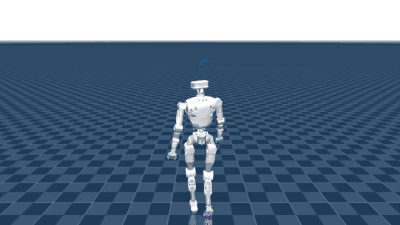](results/videos/locomotion.mp4) | [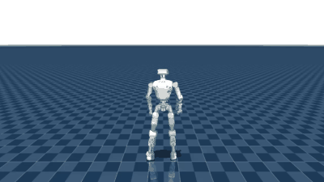](results/videos/ballet_mimic.mp4) | [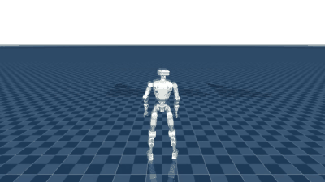](results/videos/medley_02_dance_hiphop_hip_hop_iv_R_002__A320_mimic.mp4) |

Click a GIF to open the full-length 1280×720 video.

## Quick start

1. **Train in the cloud (no local GPU needed).** Open one of the notebooks below in Colab or Kaggle,
   pick a GPU (T4 is enough), and run all cells. Each notebook installs mjlab, installs this package,
   runs a stand test, trains, then exports an ONNX policy, training curves and videos.
2. **Check the robot model locally on CPU.** Install the package and run the stand test:

   ```bash
   git clone https://github.com/nht-cyb/hu_d03_rl.git && cd hu_d03_rl
   git clone https://github.com/limxdynamics/humanoid-description.git third_party/humanoid-description
   pip install -e .          # Python ≥ 3.10, mujoco 3.16
   python scripts/stand_test.py --seconds 10
   ```

3. **Train locally** (CUDA GPU, mjlab installed). The tasks are registered through the `mjlab.tasks`
   entry point, so the usual mjlab commands work, e.g.

   ```bash
   train Mjlab-Velocity-Flat-LimX-HU-D03 --env.scene.num-envs 4096
   ```

4. **Replay a trained policy.** [results/policies/](results/policies/) has the final checkpoint (`.pt`),
   the ONNX export (`.onnx`) and, for mimic, the motion file (`.npz`) of each run. Record a headless video:

   ```bash
   python scripts/record_video.py Mjlab-Velocity-Flat-LimX-HU-D03 \
       --checkpoint-file results/policies/hu_d03_velocity_flat.pt --output-file walk.mp4
   python scripts/record_video.py Mjlab-Tracking-Flat-LimX-HU-D03 \
       --checkpoint-file results/policies/hu_d03_tracking_ballet.pt \
       --motion-file results/policies/ballet_motion.npz --output-file ballet.mp4
   ```

   Read [Modelling choices](#modelling-choices-to-know-before-deploying) before running a policy on the real robot.

## Results

All three policies were trained for 10,000 PPO iterations with 4,096 parallel environments on one
Kaggle GPU (about 6–8 h each).

| Run | Task | Training time | Final mean reward | Final episode length |
|---|---|---|---|---|
| Locomotion | `Mjlab-Velocity-Flat-LimX-HU-D03` | 5 h 56 min | 61.2 | 993 / 1000 steps |
| Ballet turn | `Mjlab-Tracking-Flat-LimX-HU-D03` | 7 h 51 min | 40.5 | 500 / 500 steps |
| Dance medley | `Mjlab-Tracking-Flat-LimX-HU-D03` (warm start) | 7 h 21 min | 34.2 | 486 / 500 steps |

### Locomotion

The policy walks forwards, backwards, sideways and turns following random velocity commands on flat ground.
The command curriculum widens at about iteration 5,000 (forward speed −1.0…1.0 → −1.5…2.0 m/s,
turn rate 0.5 → 0.7 rad/s), which explains the step in the curves.

| Before training (zero action) | Trained policy |
|:---:|:---:|
| [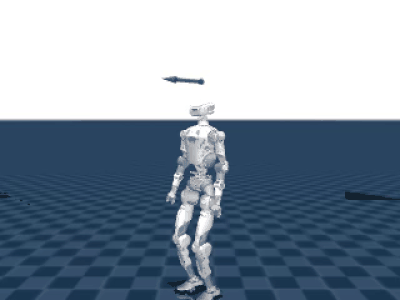](results/videos/locomotion_zero_action.mp4) | [](results/videos/locomotion.mp4) |

| Checkpoint | Command range (vx, wz max) | Falls | Linear velocity error | Yaw rate error |
|---|---|---|---|---|
| 5,000 | ±1.0 m/s, 0.5 rad/s | 0.6 % | 0.21 m/s | 0.30 rad/s |
| 9,999 (final) | −1.5…2.0 m/s, 0.7 rad/s | 1.3 % | 0.27 m/s | 0.36 rad/s |

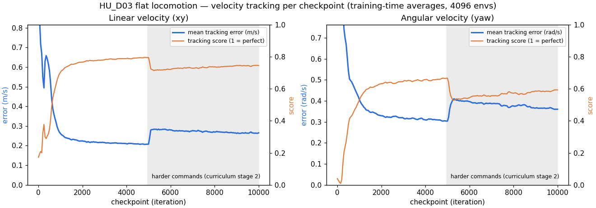

Training curves: [results/curves/locomotion_curves.png](results/curves/locomotion_curves.png).
The numbers above come from [eval/evaluate.py](eval/evaluate.py), which averages the TensorBoard
logs over the 50 iterations before each checkpoint ([eval/rows.json](eval/rows.json)).

### Mimic: ballet turn

A single BONES-SEED clip (`dance_basic_turn_v2_360_R_loop_001__A323`, found with `SEED_SEARCH = "ballet"`),
retargeted from the Unitree G1 to the HU_D03. At the end of training no episode is cut short by a tracking
failure; the mean body position error is about 4 cm.

| Reference motion | Policy in simulation |
|:---:|:---:|
| [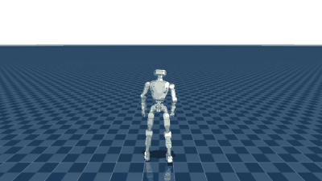](results/videos/ballet_reference.mp4) | [](results/videos/ballet_mimic.mp4) |

Training curves: [results/curves/ballet_curves.png](results/curves/ballet_curves.png).

### Mimic: dance medley

Six clips joined into one continuous motion with `scripts/make_medley_hu_d03.py` (1 s blends) and learned by
a single policy, warm-started from an earlier tracking checkpoint. Mean body position error is about 5 cm;
about 3 % of episodes end early when a hand or foot drifts too far from the reference.
Segment boundaries are in [results/policies/hu_d03_tracking_medley6.segments.json](results/policies/hu_d03_tracking_medley6.segments.json).

| 1. Walk | 2. Hip hop | 3. Mambo |
|:---:|:---:|:---:|
| [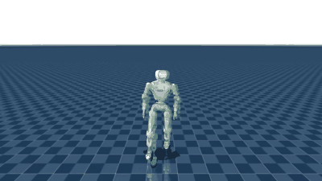](results/videos/medley_01_walk_ff_loop_180_R_002__A046_mimic.mp4) | [](results/videos/medley_02_dance_hiphop_hip_hop_iv_R_002__A320_mimic.mp4) | [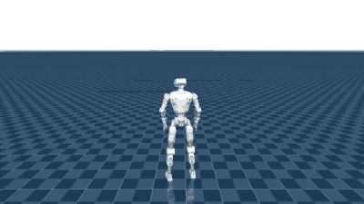](results/videos/medley_03_dance_latino_mambo_chase_180_turn_R_fast_002__A312_mimic.mp4) |
| **4. Vogue duck walk** | **5. Jive** | **6. Macarena** |
| [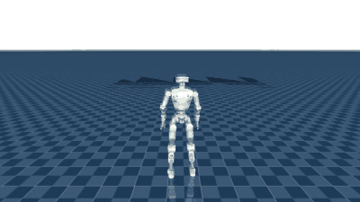](results/videos/medley_04_dance_vouge_the_duck_walk_variation_180_R_fast_002__A320_mimic.mp4) | [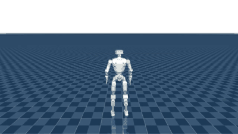](results/videos/medley_05_dance_latino_jive_sequence_R_101__A321_mimic.mp4) | [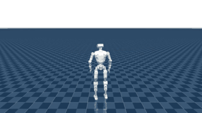](results/videos/medley_06_victory_dance_macarena_change_direction_R_loop_001__A321_mimic.mp4) |

Reference motion for the whole medley: [results/videos/medley_reference.mp4](results/videos/medley_reference.mp4).

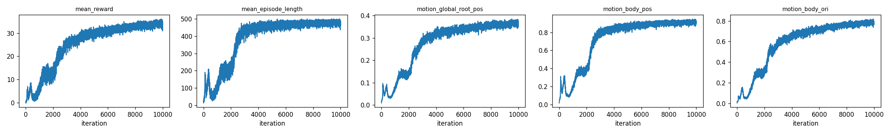

## Train on Colab / Kaggle

Upload [notebooks/train_hu_d03.ipynb](notebooks/train_hu_d03.ipynb) to Colab
(*File → Upload notebook*) or Kaggle (*Create → New Notebook → File → Import Notebook*),
pick a **T4** GPU, and run the cells top to bottom. The notebook installs mjlab,
writes this package, checks that the robot stands, and then trains:

| Task | What it learns |
|---|---|
| `Mjlab-Velocity-Flat-LimX-HU-D03` | walk following velocity commands (flat ground) |
| `Mjlab-Velocity-Rough-LimX-HU-D03` | same on rough terrain |
| `Mjlab-Tracking-Flat-LimX-HU-D03` | mimic a reference motion |
| `Mjlab-Tracking-Flat-LimX-HU-D03-No-State-Estimation` | mimic without base position/velocity in the observations |

For long unattended runs on Kaggle (*Save Version → Save & Run All*, stops itself before the 12 h limit,
resumes from the previous version's output) there are Kaggle-only notebooks:

- [notebooks/locomotion/kaggle_hu_d03_locomotion.ipynb](notebooks/locomotion/kaggle_hu_d03_locomotion.ipynb): `Mjlab-Velocity-Flat-LimX-HU-D03`
- [notebooks/mimic/kaggle_hu_d03_mimic.ipynb](notebooks/mimic/kaggle_hu_d03_mimic.ipynb): `Mjlab-Tracking-Flat-LimX-HU-D03`
  on a BONES-SEED clip found by text search (e.g. `SEED_SEARCH = "ballet"`; needs Hugging Face access and an
  `HF_TOKEN` Kaggle secret) or a LAFAN1 clip (`SOURCE = "lafan1"`)

The notebooks are generated: after editing `src/` or `scripts/`, run

```bash
python notebooks/build_notebook.py
python notebooks/locomotion/build_kaggle_locomotion.py
python notebooks/mimic/build_kaggle_mimic.py
```

## Layout

- `src/hu_d03_mjlab/robot/hu_d03_spec.py`: loads the LimX MJCF and makes a serial-joint model (removes the
  ankle/waist parallel linkages, names collision geoms, adds foot sites and IMU sensors). Needs only `mujoco`.
- `src/hu_d03_mjlab/robot/hu_d03_params.py`: armatures (from the LimX SRDF), effort limits, PD gains, home pose.
- `src/hu_d03_mjlab/robot/hu_d03_constants.py`: mjlab robot config.
- `src/hu_d03_mjlab/tasks/`: velocity and tracking task configs, registered through the `mjlab.tasks` entry point.
- `scripts/stand_test.py`: CPU stand test in plain MuJoCo.
- `scripts/retarget_g1_to_hu_d03.py`: converts G1 LAFAN1 motion CSVs to HU_D03 CSVs (joint-space transfer).
- `scripts/seed_g1_to_lafan_csv.py`: converts a BONES-SEED G1 CSV (cm, Euler degrees, 120 fps) to the LAFAN1 G1 layout.
- `scripts/make_medley_hu_d03.py`: joins several HU_D03 CSVs into one continuous clip (aligned heading and position,
  smoothstep blends) so one tracking policy learns several dances (`MEDLEY` in the Kaggle mimic notebook).
- `scripts/csv_to_npz_hu_d03.py`: HU_D03 CSV to the `.npz` mjlab's tracking task reads (local file, no W&B).
- `scripts/record_video.py`: headless rollout to `.mp4`.
- `eval/`: per-checkpoint velocity-tracking analysis of the locomotion run.
- `results/`: videos, GIF previews, training curves, checkpoints and ONNX policies of the runs shown above.

## Run the CPU checks locally

Clone the robot description into `third_party/` (or set `HU_D03_DESCRIPTION_DIR`), then with any Python that has `mujoco` 3.16:

```bash
python scripts/stand_test.py --seconds 10
```

## Modelling choices to know before deploying

- The policy commands serial `ankle_pitch/roll` and `waist_roll/pitch` joints. The real robot drives these
  through two motors each (A/B), so the targets must be converted to A/B motor commands on the robot.
  The linkage mass (about 1.4 kg) is added to the parent bodies.
- LimX does not publish PD gains. They follow mjlab's G1 rule (10 Hz, damping ratio 2 for each joint's
  armature). With 5 Hz the robot does not hold its pose. Actions are scaled by 0.25 rad.
- Mimic data is G1 motion copied to the HU_D03 joint by joint, so foot and hand positions are approximate.
